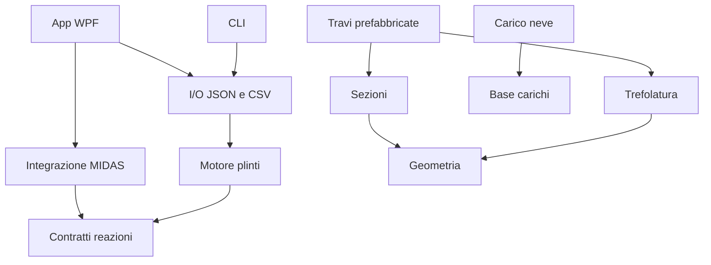

# Moduli e dipendenze

Le dipendenze sono riferimenti a progetti, senza percorsi di DLL installate sul PC. I motori in `src` compilano per `net10.0` e non dipendono da WPF, WinForms o host. I namespace storici sono conservati; i nomi delle nuove DLL identificano i moduli separati. Chi ricompila un'app esterna deve aggiornare i riferimenti alle nuove DLL: non viene garantita compatibilità binaria con vecchi eseguibili.

Materiali, vento e sisma sono librerie indipendenti. Il sisma incorpora la tabella spettrale originale con il nome di risorsa invariato; la rappresentazione in DataGridView è stata spostata in un adattatore delle interfacce storiche. I convertitori WPF dei materiali restano nelle interfacce e i modelli sono in `STA.Materiali`.

`ICalculationModule<TInput,TOutput>` descrive un servizio di calcolo tipizzato. Il modulo plinti è la prima implementazione. `IReactionSource` permette di sostituire MIDAS con altre fonti senza modificare il motore. Le altre librerie espongono le classi storiche: non vengono presentate come moduli già provvisti di una nuova UI o di un adattatore JSON specifico.

Per aggiungere una funzione: introdurre i DTO e le unità, implementare il servizio in una libreria senza UI, aggiungere test di riferimento indipendenti, registrare il progetto nel catalogo e nella soluzione, quindi collegare l'host. Non inserire formule in eventi WPF o client HTTP.

`tools/verify-architecture.mjs` controlla tutti i riferimenti, anche storici, l'assenza di cicli e la separazione dei motori dalle dipendenze Windows/native. Il catalogo `modules.json` descrive le librerie; `docs/PROJECTS.md` elenca anche host e progetti storici.
