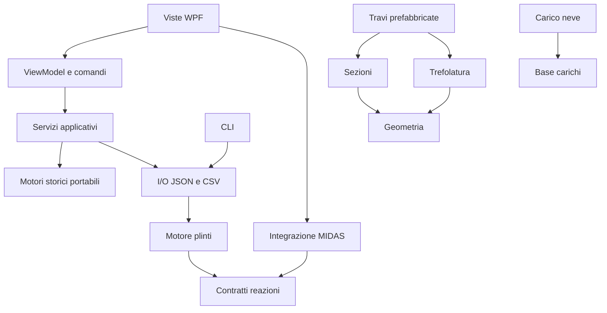

# Moduli e dipendenze

Le dipendenze sono riferimenti a progetti, senza percorsi di DLL installate sul PC. I motori in `src` compilano per `net10.0` e non dipendono da WPF, WinForms o host. I namespace storici sono conservati; i nomi delle nuove DLL identificano i moduli separati. Chi ricompila un'app esterna deve aggiornare i riferimenti alle nuove DLL: non viene garantita compatibilità binaria con vecchi eseguibili.

Materiali, vento e sisma sono librerie indipendenti. Il sisma incorpora la tabella spettrale originale con il nome di risorsa invariato; la rappresentazione in DataGridView è stata spostata in un adattatore delle interfacce storiche. I convertitori WPF dei materiali restano nelle interfacce e i modelli sono in `STA.Materiali`.

`ICalculationModule<TInput,TOutput>` descrive un servizio di calcolo tipizzato. Il modulo plinti è la prima implementazione. `IReactionSource` permette di sostituire MIDAS con altre fonti senza modificare il motore. `STA.Calcolo.Application` adatta i motori storici a `ICalculationWorkspace`, con campi, validazione, documenti JSON versionati e risultati comuni. Gli stessi servizi sono richiamati da WPF e CLI (`modulo`). `BeamProjectService` combina documenti di sezioni e trefolature. `STA.Plinti.Storici.Core` contiene le classi storiche dei plinti rese portabili, separate per file.

Per aggiungere una funzione: introdurre i DTO e le unità, implementare il servizio in una libreria senza UI, aggiungere test di riferimento indipendenti, registrare il progetto nel catalogo e nella soluzione, quindi collegare l'host. Non inserire formule in eventi WPF o client HTTP.

`tools/verify-architecture.mjs` controlla tutti i riferimenti, anche storici, l'assenza di cicli e la separazione dei motori dalle dipendenze Windows/native. Il catalogo `modules.json` descrive le librerie; `docs/PROJECTS.md` elenca anche host e progetti storici.

## Separazione MVVM

- Views: XAML e grafica. Il code-behind delle finestre contiene soltanto InitializeComponent. PlotView e PasswordBinding sono adattatori di presentazione.
- ViewModels: stato osservabile, comandi, invalidazione dei risultati; nessun riferimento alle finestre o ai dialoghi Windows. WorkspaceViewModel gestisce il flusso comune, FootingViewModel il contratto plinti/MIDAS, BeamViewModel il progetto travi, MainViewModel il catalogo. Ogni classe è in un file separato.
- Services: FileService implementa i dialoghi e l'accesso ai file, WindowService naviga e conserva il documento delle finestre nella sessione. App è il punto di composizione.
- Application/Core: calcoli, modelli, validazione e serializzazione senza dipendenze Windows.

Il controllo di architettura impedisce di reintrodurre logica nel code-behind o dipendenze di presentazione nei ViewModel. Riferimento: [data binding WPF di Microsoft](https://learn.microsoft.com/en-us/dotnet/desktop/wpf/data/).
